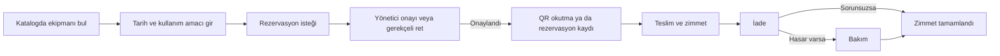

# EkipmanTakip

Kurum içinde ortak kullanılan ekipmanların katalog, rezervasyon, teslim, iade ve bakım süreçlerini mobil cihazlardan yönetmek için geliştirilmiş React Native uygulaması.

## Proje hakkında

EkipmanTakip, kullanıcıların ekipmanları inceleyip rezervasyon talebi oluşturmasını; yöneticilerin talepleri değerlendirerek ekipmanı teslim etmesini veya iade almasını sağlar. Ekipmanın yaşam döngüsü ve operasyon kayıtları Supabase üzerinden yönetilir. Uygulama Android odaklıdır ve Expo ile geliştirilmiştir.

## Öne çıkan özellikler

### Kullanıcı işlemleri

- E-posta ve parola ile kayıt ve giriş
- Parola sıfırlama ve oturumun uygulama yeniden açıldığında korunması
- Ekipman kataloğunda arama, kategori filtresi ve tarih aralığına göre müsaitlik filtresi
- Sayfalı katalog görünümü (varsayılan 20 ekipman)
- Ekipman ayrıntılarını görüntüleme ve rezervasyon isteği oluşturma
- Rezervasyon formu taslağını cihazda kullanıcıya ve ekipmana özel saklama
- Kendi rezervasyonlarını ve zimmet geçmişini takip etme
- Uygulama içi bildirimleri görme ve okunma durumunu güncelleme

### Yönetici işlemleri

- Ekipman ve kategori ekleme, düzenleme ve pasife alma
- Rezervasyonları inceleme, onaylama veya ret gerekçesiyle reddetme
- Onaylı rezervasyon için teslim ve iade kaydı oluşturma
- Açık ve tamamlanmış zimmetleri görüntüleme
- Ekipmanı bakıma alma ve bakım tamamlandığında yeniden kullanıma açma
- Profil rolüne göre yönetici işlemlerine erişme

### QR ve bağlantı

- Cihaz kamerasıyla ekipman QR/barkodunu okuma
- Kamera kullanılamadığında ekipman kodunu elle girme
- Son başarılı ekipman katalog sorgularını yerel önbellekten açma
- Bağlantı durumunu izleme ve internet geri geldiğinde sunucu verilerini yenileme

## Kullanılan teknolojiler

| Alan | Teknoloji |
|---|---|
| Mobil uygulama | React Native, Expo, TypeScript |
| Gezinme | React Navigation |
| Sunucu ve kimlik doğrulama | Supabase Auth, PostgreSQL ve Supabase JavaScript istemcisi |
| Sunucu verisi ve önbellek | TanStack Query, AsyncStorage persister |
| Formlar | React Hook Form, Zod |
| Kamera | Expo Camera |
| Bağlantı durumu | React Native NetInfo |
| Güvenli oturum saklama | Expo SecureStore ve AsyncStorage |

Sürüm ayrıntıları `package.json` ve `package-lock.json` dosyalarında bulunur.

## Ekranlar ve gezinme

Kimlik doğrulama akışında giriş, kayıt ve parola sıfırlama ekranları yer alır. Oturum açıldıktan sonra ana gezinme dört sekmeden oluşur:

| Sekme | İçerik |
|---|---|
| Ana Sayfa | Kullanıcıya veya yöneticiye uygun özet ve kısayollar |
| Ekipmanlar | Katalog, arama, filtreleme ve ekipman ayrıntısı |
| İşlemlerim | Rezervasyonlar ve zimmet kayıtları |
| Profil | Hesap bilgileri, bildirimlere erişim ve çıkış |

Ek ekranlar rezervasyon formu, QR okutma, bildirimler, yönetici rezervasyonları, ekipman, kategori, zimmet ve bakım yönetimini kapsar.

## Rezervasyon ve ekipman akışı



İstemci rezervasyon oluşturma, onay, ret, teslim, iade ve bakım değişikliklerini Supabase RPC çağrılarıyla yürütür. Bu işlemlerin veri bütünlüğü kuralları sunucu tarafında uygulanır.

## Proje yapısı

```text
.
├── App.tsx
├── app.json
├── index.ts
├── package.json
├── assets/
└── src/
    ├── components/
    ├── hooks/
    ├── navigation/
    ├── screens/
    │   ├── admin/
    │   ├── app/
    │   └── auth/
    ├── services/
    ├── theme/
    └── types/
```

- `src/screens/`: kullanıcı, kimlik doğrulama ve yönetici ekranları
- `src/services/`: Supabase erişimi, iş akışı çağrıları ve rezervasyon taslağı saklama
- `src/navigation/`: kimlik doğrulama yığını, ana sekmeler ve uygulama ekranları
- `src/hooks/`: oturumun yüklenmesi ve değişimlerinin izlenmesi
- `src/types/`: ekipman, kategori ve rezervasyon tipleri
- `App.tsx`: sorgu önbelleği, kalıcı ekipman verisi ve ağ bağlantısı davranışı

## Kurulum

### Gereksinimler

- Node.js ve npm
- Android emülatörü veya Android cihaz
- Supabase projesi

### Depoyu indirme

```bash
git clone https://github.com/OzgunDenizSevilmis/EkipmanTakip.git
cd EkipmanTakip
npm install
```

### Supabase bağlantısı

Uygulama `src/services/supabase.ts` içinden şu Expo ortam değişkenlerini kullanır:

```text
EXPO_PUBLIC_SUPABASE_URL
EXPO_PUBLIC_SUPABASE_PUBLISHABLE_KEY
```

Değerleri yerel Expo geliştirme ortamında tanımlayın. Mobil uygulamaya Supabase `service_role` anahtarı veya başka bir sunucu sırrı eklemeyin.

İstemci aşağıdaki veri tablolarıyla çalışır: `profiles`, `categories`, `equipment`, `reservations`, `loans`, `maintenance`, `notifications`.

İşlemler için çağrılan Supabase fonksiyonları:

```text
get_equipment_catalog
create_reservation
approve_reservation
reject_reservation
deliver_equipment
return_equipment
deactivate_equipment
start_maintenance
complete_maintenance
```

Bu tabloların ve fonksiyonların Supabase projesinde tanımlı ve oturum rollerine göre yetkilendirilmiş olması gerekir. Veritabanı şeması projeye özel kurulumun parçasıdır.

### Uygulamayı başlatma

```bash
npm run start
```

Android emülatöründe çalıştırma:

```bash
npm run android
```

## Geliştirme komutları

| Komut | Açıklama |
|---|---|
| `npm run start` | Expo geliştirme sunucusunu başlatır |
| `npm run android` | Expo’yu Android hedefiyle başlatır |
| `npm run ios` | Expo’yu iOS hedefiyle başlatır |
| `npm run web` | Expo’yu web hedefiyle başlatır |
| `npm run lint` | ESLint denetimini çalıştırır |
| `npm run format` | Prettier ile biçimlendirme uygular |
| `npm run format:check` | Biçimlendirme farklarını denetler |

## Veri ve erişim yaklaşımı

- Kullanıcı kendi rezervasyon, zimmet ve bildirim ekranlarını kullanır; yöneticiler operasyon ekranlarından ekipman ve rezervasyon süreçlerini yönetir.
- Ekipman durumu `ACTIVE`, `MAINTENANCE` veya `INACTIVE` olarak tutulur. Tarih aralığına göre müsaitlik katalog sorgusunda değerlendirilir.
- Oturum bilgisi için AsyncStorage ve Expo SecureStore kullanan bir saklama katmanı yapılandırılmıştır.
- Ekipman sorgularının başarılı sonuçları AsyncStorage tabanlı sorgu önbelleğinde en fazla 24 saat tutulur. Rezervasyon taslakları kullanıcı ve ekipman kimliğine göre anahtarlanır.
- Yönetici anahtarı istemciye konulmaz. Yetkilendirme ve kritik durum geçişleri Supabase tarafında uygulanmalıdır.

## Projede yapılan kontroller

Proje geliştirme sürecinde raporlanan manuel kontroller; kayıt/giriş ve oturum, rezervasyon oluşturma ve tarih doğrulama, onay/ret, teslim/iade, hasarlı iadede bakım durumuna geçiş, QR ve bildirim akışları ile çevrimdışı katalog/taslak deneyimini kapsar. Kullanıcılar arası doğrudan API izolasyonu, eşzamanlı rezervasyon onayı ve hata anında işlem bütünlüğü bu manuel ekran kontrollerinden ayrı backend doğrulamaları gerektirir.

Depoda otomatik test dosyası veya `test` npm komutu bulunmuyor. Lint ve biçim denetimi için yukarıdaki komutlar tanımlı.
